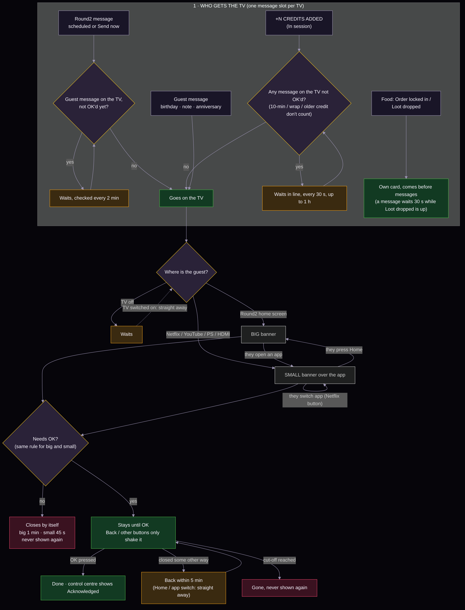
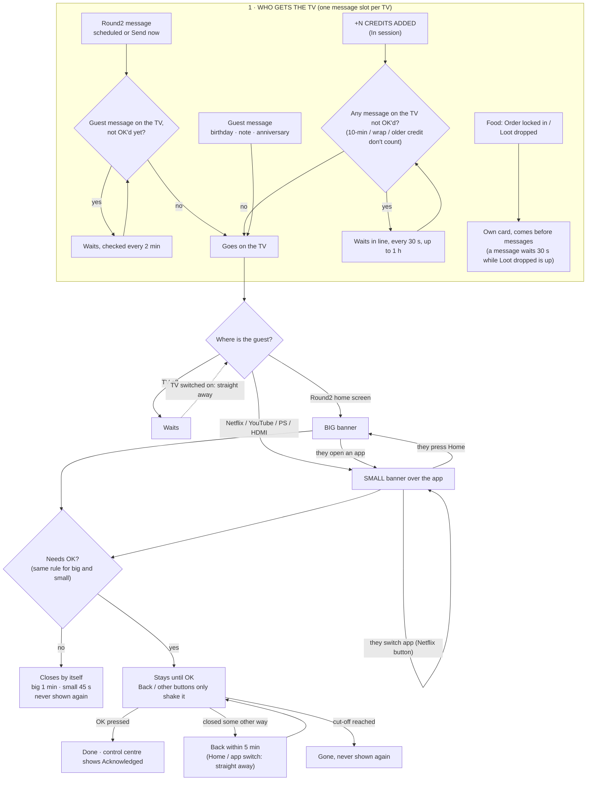
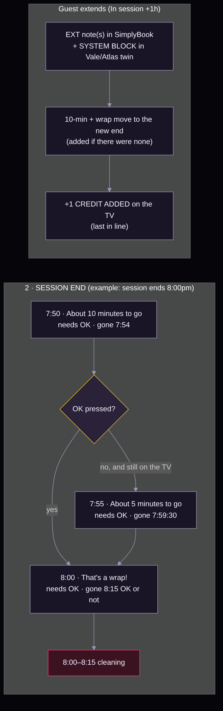
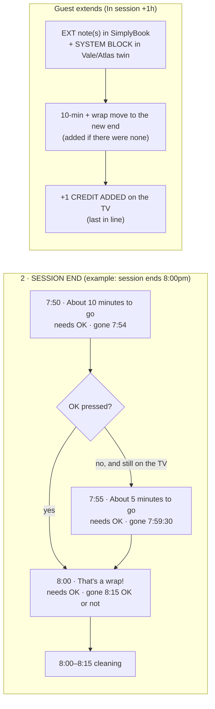

# TV notifications: timers and priorities (start here)

One page for everything that pops up on a room's TV: guest messages, Round2 messages, the session-end reminders, the
"+N CREDITS ADDED" banner and the food alerts. Owner's rules as of **31 Oct 2026**. Details and history are in
[guest-messages.md](guest-messages.md); this page is the summary another Claude should read first.

Words the owner uses: **big banner** = on the Round2 home screen; **small banner** = over an app (Netflix, YouTube,
PlayStation/HDMI). "Needs OK" = must be acknowledged.

## 1 · Who gets the TV, and how a banner behaves

Each TV has **one message slot** (Firebase `/r2/<TV_KEY>/<room>/msg`; OK goes to `msgAck`). Priority:
**guest message > Round2 message > +N CREDITS ADDED**. Food alerts have their own card and come before messages.

## 2 · Session end and extensions

## 3 · Cut-offs (gone at the latest, OK or not)

| Message | Cut-off |
|---|---|
| Guest message (birthday, note, anniversary, celebrate) | booking start + 3 h (follows the booking if it moves) |
| Round2 message (control centre) | show time + 3 h |
| About 10 minutes to go | + 4 min |
| About 5 minutes to go (only if the 10-min one wasn't OK'd) | 30 s before That's a wrap |
| That's a wrap! | + 15 min (guests usually just read it and leave) |
| +N CREDITS ADDED | 20 min if it needs OK, 5 min if not; waits in line up to 1 h |
| Order locked in | 20 s |
| Loot dropped | until OK; back every 5 min if not on screen |
| Test bench | 1 h |

No OK needed: big banner 1 min, small banner 45 s, then never again.

## Where each rule lives (code map)

| Rule | Where |
|---|---|
| Queue, push 1 min before, Round2 waits for an unread guest message (every 2 min) | round2sg-home `worker/round2-book.js` `qRun` |
| Messages follow their booking (moved/cancelled) | same file, `follow`, `/sb/notify/<key>` |
| 5-minute reminder | same file, `nudgeAdd` / `nudgeRun` |
| Credit banner, waits in line (every 30 s, 1 h) | same file, `sessBanner`, `tvBusy`, `bqRun` |
| In session (+1/+2/+3 h, EXT notes, Vale/Atlas SYSTEM BLOCK, undo) | same file, `insess`, `extend`, `extUndo`; control centre `manager/index.html` `Sess` |
| Cut-off values written into each message | Make GUEST MESSAGE LINKS (`end`/`until`), `manager/index.html` send-now |
| Android small banner, OK/shake, cut-off, re-show, Home → big banner | `app/.../FoodAlerts.java` (`msgTick`, `showMsgPage`, `menuInFront`, `menuLeft`) |
| Android big banner hand-off, page still loading | `app/.../MainActivity.java` `showMsg`, `pendingMsg` |
| Big banner on the home screen (Android + LG), cut-off, coin animation | `web/index.html` `Msg` |
| LG small banner (Round2 Alerts app) | `webos/alerts/index.html` |
| LG helper: when to pop, card.up, Home / app switch / power on | `webos/service/round2d.sh` `watch_apps`, `msg_tick`, `card_up`, `food_again` |

## Tested / not yet tested on real TVs (31 Oct 2026)

- Tested by the owner: small banner over Netflix on Bella (LG); Home → big banner bug found and fixed (v1.0.187).
- Fixed, waiting for a TV test: big banner closing at its cut-off (v1.0.189, Max); app-to-app switch on LG;
  5-minute reminder; credit banner waiting in line.

Redraw the pictures from the mermaid blocks above (`mmdc -i x.mmd -o x.png -b '#06050A'`) when a rule changes.
